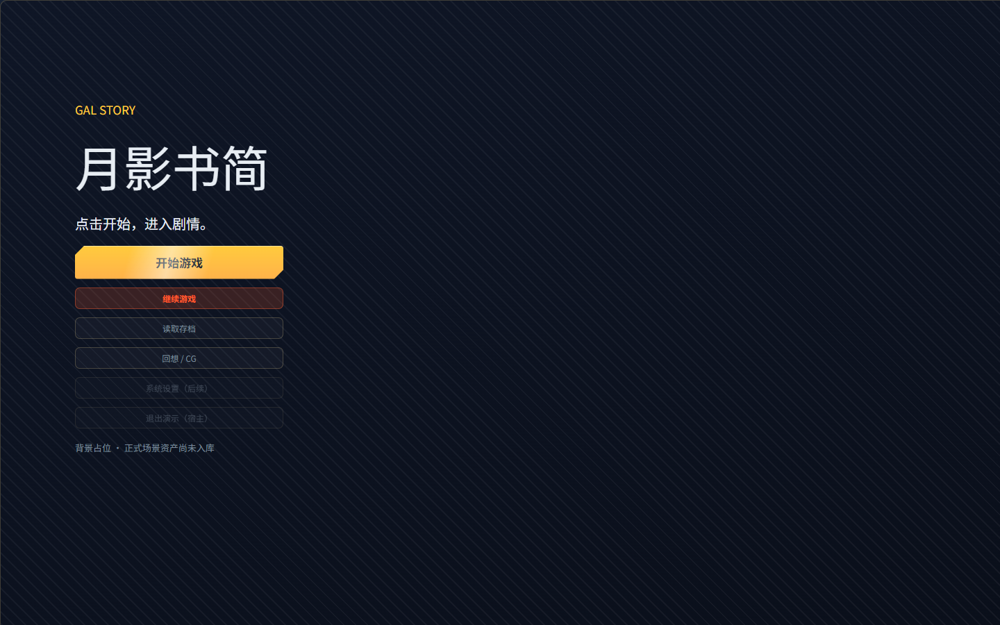
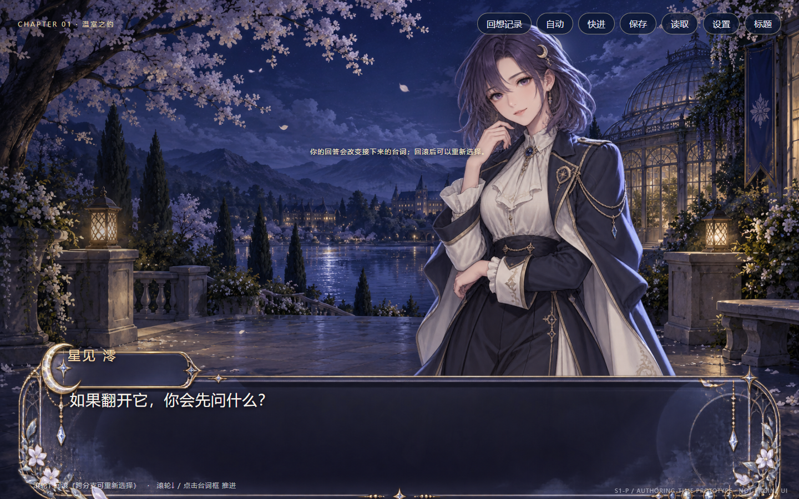
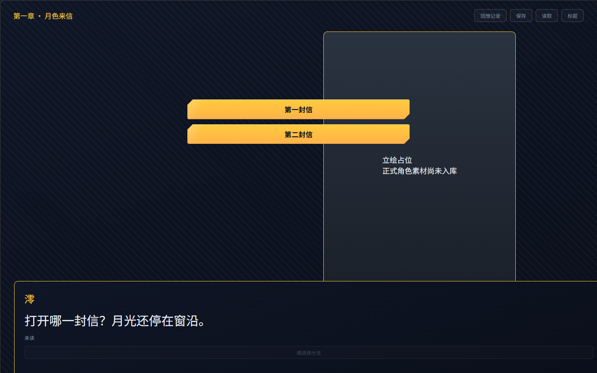
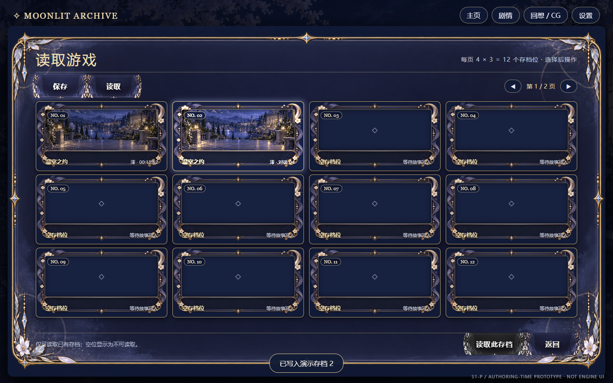
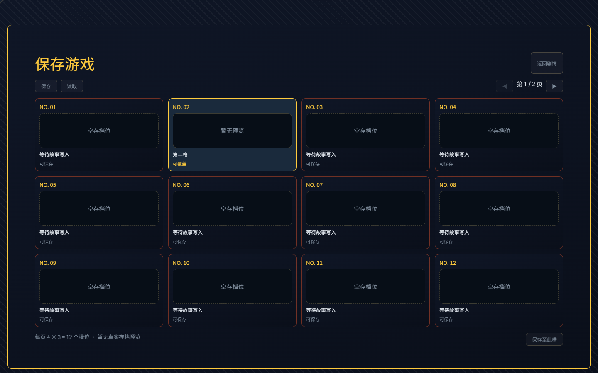

# GAL-UI-03A · S4 结构对齐与缺口单（2026-10-10）

基准：owner 定稿 `gal-ui-complete-v2.dc.html`，逻辑画布 1440×900。下列三组均为同画布截图；右侧是真实 `mountUI` + `apolloOnyx` + `LayoutNode` 静态状态，不消费设计稿图片。右侧占位背景、立绘、框皮均明确标注，不冒充 S5/S6 视觉对齐。

| 定稿 V2 | S4 真实 LayoutNode |
|---|---|
|  |  |
|  |  |
|  |  |

另有 [读取确认态](./review/gal-ui-03a-confirm.png)、[主页主键 hover 态](./review/gal-ui-03a-home-hover.png)、[主页主键 pressed 态](./review/gal-ui-03a-home-pressed.png)、[空槽选中但读取键禁用态](./review/gal-ui-03a-load-empty.png)。03A 当时“回想/CG、设置、退出”均禁用；03B 接入后画廊入口已启用，重拍的 03A 主页图会反映这一演进，设置与退出仍禁用。这些图证只覆盖纵切片代表态，不等于完整 V2 全态验收。

可复跑入口位于 `src/services/gal-ui/`，不修改 PUI 独占的 `tools/audits/**`：

```powershell
# 工作目录：仓库根。无头 Edge 只读访问本地静态构建，无应用服务。
node src/services/gal-ui/verify-gal-slice-audit.mjs
$LASTEXITCODE
$env:UI_AUDIT_CHROMIUM='C:\Program Files (x86)\Microsoft\Edge\Application\msedge.exe'
 node src/services/gal-ui/capture-gal-slice.mjs
$LASTEXITCODE
node src/services/gal-ui/verify-gal-live-wheel.mjs
$LASTEXITCODE
```

五态审计逐一构建/运行 home、story、slots、load-empty、confirm 静态入口；三个命令均以 `finally` 关闭短生命周期浏览器/删除任务级临时构建。Windows 若 Edge 不在默认位置，先设置 `UI_AUDIT_CHROMIUM`。静态截图命令只覆盖同名审计关键帧，并对主页禁用键、空槽读取禁用、确认 Modal 可见做真浏览器断言。最近一次审计的逐屏原始 stdout 与退出码保存在 [`review/gal-ui-03a-ui-audit.raw.txt`](./review/gal-ui-03a-ui-audit.raw.txt)，复查者可独立重跑对照。

真浏览器玩家链另由 `verify-gal-live-wheel.mjs` 验收：它把真实 GAL World/宿主和内存存档端口挂载到本地静态页，用 1440×900 隔离 Edge 实际点击、滚动，依次验证进入剧情、已读、下滚到稳定 ID 选项、选择、上滚回退、重选、2 号槽确认保存/读取、恢复剧情且 Profile 已读不回退。2026-10-10 本地退出 **0**，原始摘要见 [`review/gal-ui-03a-live-wheel.raw.txt`](./review/gal-ui-03a-live-wheel.raw.txt)。关键帧：[初始台词](./review/gal-ui-03a-live-intro.png)、[滚轮到选项](./review/gal-ui-03a-live-choice.png)、[回退后重选](./review/gal-ui-03a-live-rechoice.png)、[2 号槽保存](./review/gal-ui-03a-live-saved-slot2.png)、[2 号槽读取恢复](./review/gal-ui-03a-live-loaded-slot2.png)。浏览器及临时构建已在 `finally` 关闭/清理；无应用服务。

## 逐条差异与去向

| 目标 | 当前证据 | 裁决去向 |
|---|---|---|
| 主页左侧标题/六键、右侧主视觉 | 左侧锚点已对齐约 x108；标题读取 package 数据。右侧场景图为显式占位；后三键禁用并标后续 | 左侧结构保留；场景与后三个完整页面不属 03A，S5/后续工单接线，不能宣称 V2 全屏完成 |
| 剧情顶栏、右侧立绘、底部台词框、稳定 ID 选项 | 三层位置、信息层级及真实选择动作已有；背景/立绘/框皮均为占位，选项按钮为可触发纯数据 | 03A 结构已接；素材/皮/动效 S5/S6；原型的历史、自动、快进、设置入口不在本纵切片内，须后续另单，不能算 1:1 全屏 |
| 存读档 4×3、12 槽/页、两页、选中、空槽禁读 | 真浏览器截图证实网格位于约 x84–1356、y238–790；`GalUiReadModel` 每页 12 格，页码/选中/禁读/确认由宿主驱动 | 结构已接。原型卡片缩略图与华丽皮未入库，当前显式“暂无预览/空存档位”；S5 资产线处理 |
| 保存空槽、覆盖、读取、新游戏确认 | `Modal.size='xl'`、默认确认策略已接；新游戏仅已有进度时确认 | 03A 内完成；六项独立可关闭偏好不在本纵切片，另按存档线裁决 |
| 滚轮↑回滚、↓推进 | PUI-03B 独立局部 PASS 后，GAL 剧情区域声明式配置 `Panel.wheel`，只填 `narrative.back/advance`；真实挂载单测及真浏览器玩家链退出 0 | 先前阻断已由 03A 非施工者独立复查关闭；无 GAL 层 DOM wheel 监听 |
| 已读判定 | S4 使用同步完整 Label；真实 mount/update 后才调用 `PresentationReadGate.fullyPresented`，in-memory DOM 测试通过。未来打字机必须改为末字回调 | 03A 完成；S6 打字机接入时重审 |
| Profile 与存档 | 2 号槽保存/读取恢复叙事 World，已读 Profile 由独立端口保存并不随 World 回退 | 定向实证通过；测试仅用内存端口，agent 未碰持久化数据库 |

## 缺口裁决：真实滚轮输入

实查原文：`docs/playbooks/pick-list.md` 将 VN 剧情解释交给 `t3-narrative-director`；catalog 中 `i1-input-capture` 说明“RawInput 由运行时（DOM 监听等副作用层）每帧注入；action-map(I2) 把它翻译成语义动作。本原子只定义契约，捕获本身是运行时职责”；`t2-keybind` 只解释已存在的具名输入动作。`docs/playbooks/ui.md` 的 `mountUI`/ActionSink 负责 `action` 信号；对 `src/ui/components/{types,server,render}.ts` 搜 `wheel|deltaY` 无命中。故纯 LayoutNode/现有 ActionSink 无法把真实 WheelEvent 送进 `narrative.back/advance`；独立复查真实挂载探针确认失败。未执行 skill 提到的 Git 拉取，因为 Owner 本机禁令禁止 agent 任何 Git 操作。

GAL 策划复核：只读执行 `npx vite-node scripts/dump-capability-catalog.mjs --only i1-input-capture,i2-action-map,t2-keybind` 退出 0；机读目录确认 `i1` 仅定义 RawInput/注入契约，捕获属运行时，`i2` 仅映射已有 RawInput，`t2-keybind` 只消费已有具名输入。另在 `src/renderer`、`src/launcher`、`src/ui`、`src/skills`、`src/services` 实查 `wheel|WheelEvent|deltaY|onWheel|mousewheel`，仅 GAL 新宿主有直接调用 `wheel(deltaY)` 的方法及测试，未发现通用 mountUI wheel 捕获。此复核不改变 owner A/B 裁决要求。

| 路线 | 代价 | 影响面/通用性 | 选错代价 |
|---|---|---|---|
| **A 补 PUI 通用输入口（推荐）**：由 PUI 在 mountUI/声明式输入映射层收 wheel↑/↓，发具名 ActionSink；GAL 仅填 action 名 | 需 PUI 施工+独立复查+浏览器回归 | 共享 UI/runtime；其他 VN/菜单可复用，维持无游戏层 DOM | 若接口过宽，增加引擎复杂度；需要先限为 wheel 方向闭集与作用域 |
| **B 准许 GAL 宿主局部 DOM wheel 监听例外**，登记技术债 | 当下改动少，但需例外审批、生命周期/嵌套滚动/Modal 焦点测试 | GAL 独有；与其他游戏重复风险高，破坏“游戏层不手写 DOM 输入”边界 | 后续 PUI 下沉时迁移成本及行为分叉，可能形成隐性绕基座先例 |

**owner 判词（2026-10-10）：A，由 PUI 补通用滚轮方向→具名 ActionSink 接口。** B 的 GAL 局部 DOM 监听例外不采用；施工验收规格见 `requests.md · GAL-PUI-03B`。PUI-03B 与 GAL-UI-03A 均已独立局部 PASS；03A 仅签 S4 结构纵切片，不签完整 V2 或 S5/S6，详见 [`review/GAL-UI-03A.md`](./review/GAL-UI-03A.md)。

## 验证摘要

- `validateLayoutNode`：home/story/slots/load-empty/confirm 零 issue；实测屏幕节点 id 唯一，意图叠层仅背景/立绘与 Modal 遮罩显式豁免。布局从原型截图逐屏量边界，不用自由 DOM/CSS 表达。
- `vitest`：03A 主链、真实挂载已读、真实 `WheelEvent` 下滚/上滚/重选/非故事页不响应测试通过；先前独立 wheel 探针红灯由 PUI-03B 修复并有独立局部 PASS。
- `ui-audit`：主页、剧情、存档、读取空槽、确认五态 1440×900，逐态重叠 0、硬对比失败 0、AA 警告 0、border-image 前提失败 0；确认框与背景的有意叠层显式 `allowOverlap`。读取空槽小字最初 4.24:1，修为语义 `text` 后警告归零。Modal 有不透明内容底与深遮罩，空槽禁用键不会穿透；主页/剧情华丽件各 2，存档页 `Panel.glass` 命中 1。`apolloOnyx` 主题确实传入 `mountUI`，审计器的“house 主题：否”是仅检测皮图的启发式结果，不代表默认 SHELL；无正式皮图的 S4 结构阶段不伪造该命中，S5 仍需资产专职接真皮。审计工具仅打开本地静态构建，临时无头 Edge 已关闭。
- 全库 `tsc`：退出 1，仅非 GAL 现有错误，不能宣称全库门禁绿。
