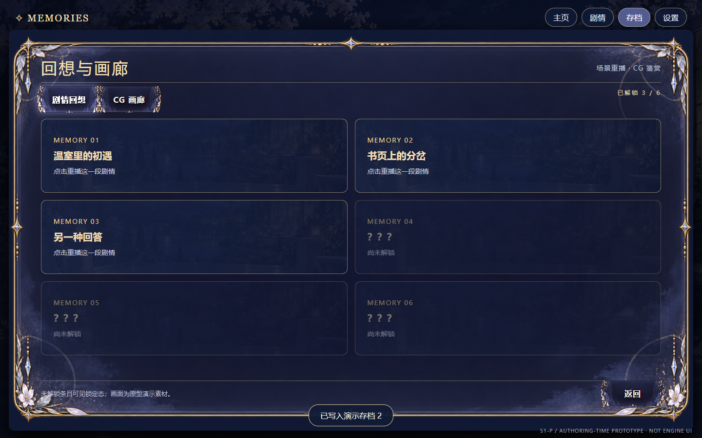
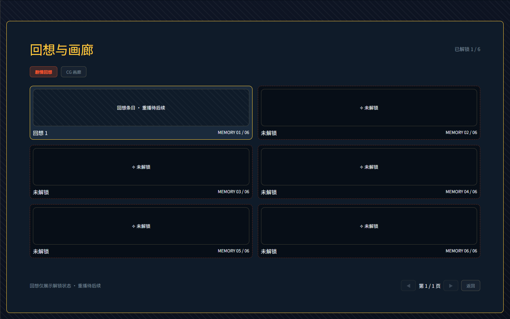
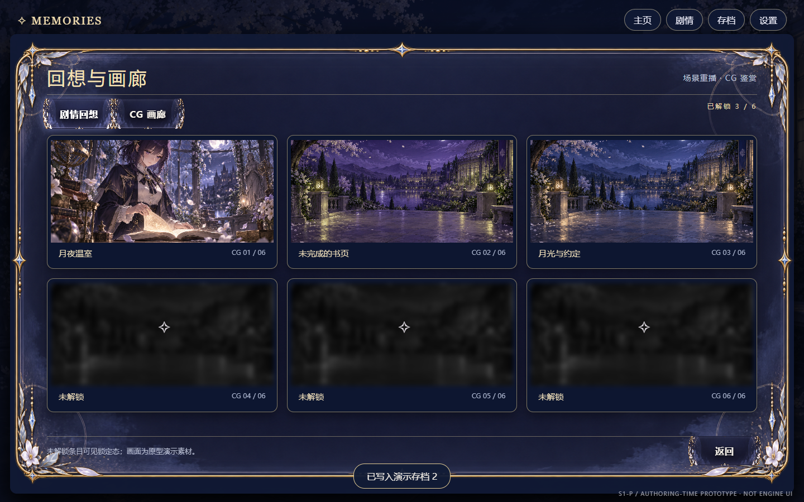
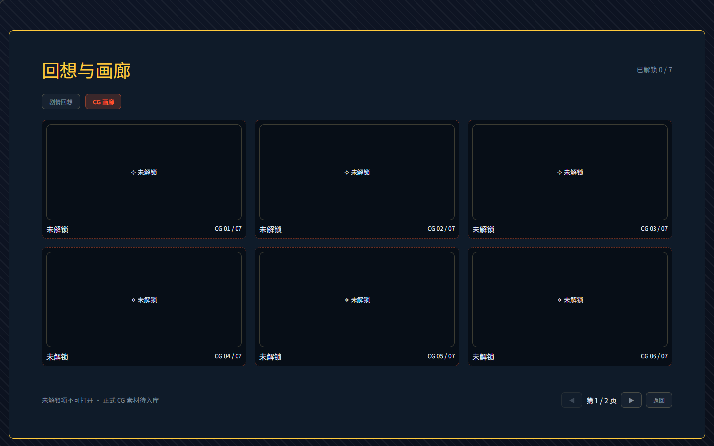

# GAL-UI-03B · 历史与画廊 S4 结构对照（2026-10-10）

基准是 owner 定稿的 `gal-ui-complete-v2.dc.html`，逻辑画布 1440×900。右图是真实 `mountUI` + `apolloOnyx` + LayoutNode、内存 GAL World/Profile 与本地静态构建；没有复制原型 DOM/CSS/JS、演示 CG 或导入未登记素材。CG 缩略图和大图均明确写着“正式素材尚未入库”。

| 原型关键帧 | 真实结构关键帧 |
|---|---|
|  |  |
|  |  |

历史原型的 `.overlay-panel.wide` 为约 1080×610、`.history-list` 可用高度 430；真实 [历史弹层](./review/gal-ui-03b-live-history.png) 是同尺 wide Modal，记录区固定 430，并有 [24 条记录滚动后截图](./review/gal-ui-03b-history-scrolled.png)。[CG 放大层](./review/gal-ui-03b-live-cg-expanded.png) 用 wide Modal 和高 482 的大图占位；[关闭后保持第 2 页](./review/gal-ui-03b-live-cg-return.png)。可点 CG 有 [hover](./review/gal-ui-03b-live-cg-hover.png) 与 [pressed](./review/gal-ui-03b-live-cg-pressed.png) 关键帧；锁定卡无 action，首尾页导航禁用。回想卡即便解锁也只读，不提供重播入口。

## 逐条差异及去向

| 目标 | S4 真实结果 | 去向 |
|---|---|---|
| 画廊 3×2 CG、2×3 回想、底部导航 | 外框 x18/y60，卡片左锚 x84、三列/两列和分页行为与原型一致；当前网格顶 y233，原型约 y244，纵向节奏差约 11px；当前卡片比原型略高，底栏随内容而非固定底锚 | S4 信息结构与路径已接；这两项实测偏差保留，不称像素 1:1。后续 UI 基座/正式皮施工时按原型重排并重拍，不能修改原型追认 |
| 画廊已解锁计数、锁态、标题 | 数字来自本 package 的目录/Profile；稳定 ID 排序、locale 标题。锁卡只显“未解锁”，无源图/key 与动作；混合回想锁态实拍中已解锁卡仍无 action；外部 Profile 刷新后可开已解锁 CG | 本票完成；`gallery.memories` 只读，不假装 C5b 重播 |
| CG 缩略图、背景、花纹、金框 | 位置由 LayoutNode 占位，正式资产缺失；原型的演示 CG、模糊锁图与花纹未用于运行时 | S5 资产/美术债，不能据此签视觉 1:1；资产导入与 index 非本票施工权限 |
| 历史宽弹层、当前游标、说话人、文本、430 高滚动 | 宽弹层/可用高度与原型量级一致；只展示当前 cursor 及以前、至多 512 条，空历史文案明确；长列表实滚动且背景 wheel 未泄漏 | 本票完成；原型金框与字体纹样仍属 S5 |
| CG 大图遮挡/关闭 | 1080×610 wide Modal 遮挡底图；482 高大图占位，关闭后仍在相同页；锁卡不能打开 | 本票完成；正式图像及切换演出 S5/S6 |
| 默认、hover、pressed、disabled、locked | 默认/锁态首屏、可点 CG hover/pressed、首页末页导航禁用均有真浏览器图证；回想卡不可点 | 本票结构态覆盖；精致视觉反馈在 S5 重审 |

## 可复验与边界

- `npx vitest run src/services/gal-ui`：3 文件 22/22，退出 0；含 `validateLayoutNode` 对历史、画廊、放大态零 issue。只读投影覆盖空窗、512 窗、当前游标、旧未来裁剪、跨 package 同 ID、Profile 刷新、锁态隐藏。
- `node src/services/gal-ui/verify-gal-03b-audit.mjs`：history/gallery/expanded 三态分别重叠 0、硬对比失败 0、AA 警告 0、border-image 前提失败 0，退出 0。gallery/expanded 命中 `glass` 与 `juice`；`apolloOnyx` 实际传入 mountUI，审计器“house 主题：否”是未见主题贴图的启发式提示，正式皮仍待 S5。
- `node src/services/gal-ui/verify-gal-live-gallery.mjs`：真实点击与 WheelEvent 完成历史开/滚/关、背景隔离、回想与锁卡、Profile 解锁刷新、第 2 页 CG 放大/返回、剧情继续/回退，退出 0。额外静态 24 行列表真实 scrollTop 增长；浏览器与临时构建在 finally 关闭/清理。无应用服务、数据库写入或持久化浏览器配置。
- 03A 回归 `node src/services/gal-ui/verify-gal-live-wheel.mjs`：滚轮、改选、2 号槽存/读与 Profile 保留，退出 0。`capture-gal-slice.mjs` 已跟随本票改为画廊入口启用断言；设置/退出仍禁用。
- `npx tsc --noEmit --pretty false`：退出 1，报错仅在 `game-card-reveal`、`game-dice`、`game-simlife`、`game-theft`、`src/launcher/game-runner.tsx`，没有 GAL 文件。不得称全库门禁绿或已推送。

本单只签历史与画廊的 S4 结构切片；C5b 重播、正式 CG、完整 V2 的设置/自动/快进、S5/S6 与全库绿灯均不在此结论中。独立复查者须自行复跑、带锚点隔离撤修验红、验证实际行为并读告警，不能把本导航当证据。
