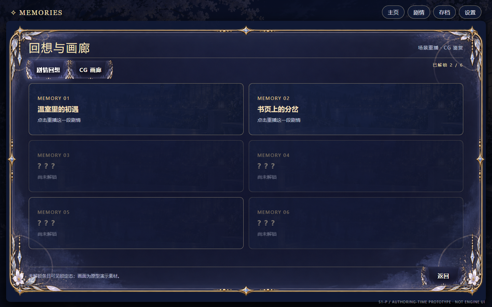
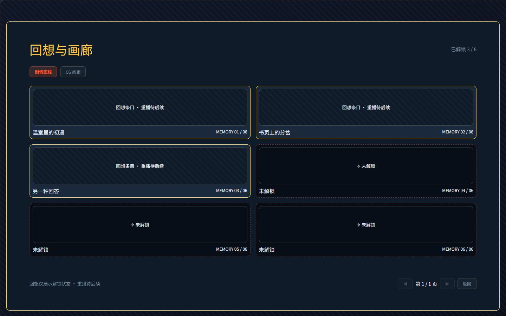
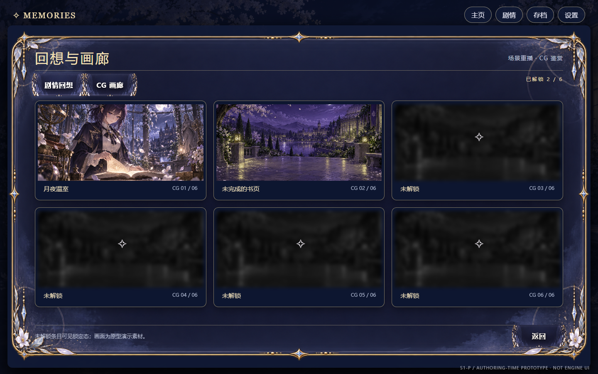
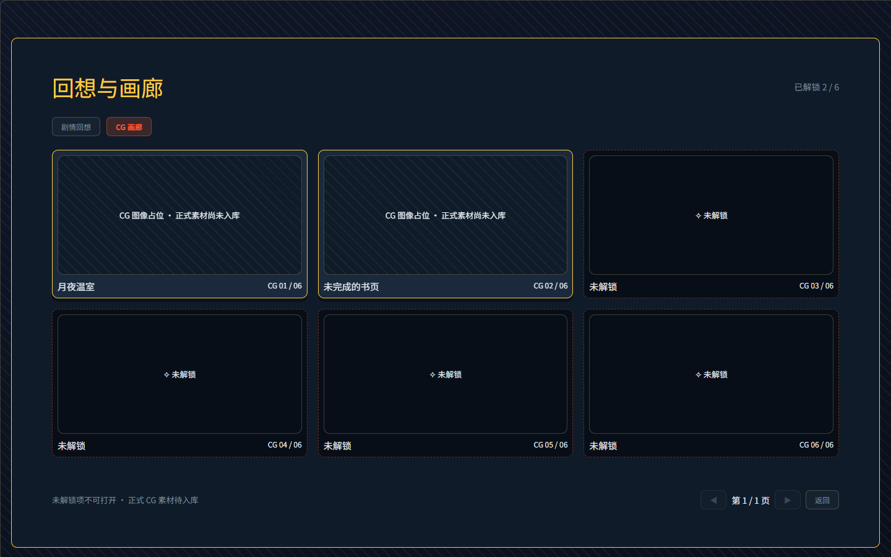

# GAL-UI-03C · 画廊 S4 几何收敛证据（2026-10-10）

本票只对 owner 定稿 `gal-ui-complete-v2.dc.html` 做 1440×900 结构量测。原型与真实 `mountUI`/LayoutNode 在同一个隔离 Edge 会话、相同画布中取 DOM 包围盒；真实画面用 `apolloOnyx` 主题。程序侧没有修改原型、PUI 基座或资产库。完整原始量测在 [`review/gal-ui-03c-geometry.json`](./review/gal-ui-03c-geometry.json)，可用 `node src/services/gal-ui/measure-gal-03c.mjs` 重新生成并断言。

| 定稿原型 | 真实 LayoutNode |
|---|---|
|  |  |
|  |  |

以下为 `x,y,w,h`，单位 px。表中“前值”取 03B 真实截图/差异单的实测描述；03B 未记录的精确数字不倒填。

| 边界 | 03B 前值 | V2 目标 | 03C 实值 | 最大几何偏差 |
|---|---|---|---|---|
| 两页外框 | x18,y60；高度未精量 | 18,61,1404,824 | 18,61,1404,824 | 0 |
| 两页标题区 | 未精量 | 84,109,1272,61 | 84,109,1272,61 | 0 |
| 两页页签 | 未精量 | 84,182,1272,44 | 84,182,1272,44 | 0 |
| 回想网格 | 顶 y≈233，卡略高 | 84,244,1272,486 | 84,244,1272,486 | 0；原约 11px 顶偏差关闭 |
| 回想首卡 / 末卡 | 高度未精量 | 首 84,244,628.5,152；末 727.5,578,628.5,152 | 同目标 | 0 |
| CG 网格 | 顶 y≈233，卡略高 | 84,242,1272,497 | 84,242,1272,497 | 0；原约 9px 顶偏差关闭 |
| CG 首卡 / 末卡 | 高度未精量 | 首 84,242,412.656,240；末 943.328,499,412.656,240 | 同目标 | ≤0.016，浏览器小数布局 |
| 两页底栏 | 随内容漂移 | 84,782,1272,51 | 84,782,1272,51 | 0 |
| 底栏动作区锚位 | 未精量 | y787，右沿1356，高42 | y786.5，右沿1356，高42 | y 偏 0.5 |

底栏动作区的真实宽度约 223.58，原型只有返回按钮、宽 116。真实产品为超过 6 个 CG 保留上一页/页码/下一页，故比较其右沿、高度与底栏锚位，不要求按钮集合宽度相同；这是本票明确保留的内容差异，不是像素 1:1 的宣称。标题文本/字体、CG 正式图、纹样与背景仍是 S5/S6 视觉债。

空 CG 态仅有明确的“暂无可浏览的 CG”提示，[真实空态](./review/gal-ui-03c-current-empty.png) 底栏仍为 y782；第 2 页只有一张卡，[真实第 2 页](./review/gal-ui-03c-current-page2.png) 的卡顶 y242、底栏仍为 y782。定稿原型没有这两个边界状态，它们仅以同一布局锚点验收，不能假称与原型逐像素对拍。锁卡不暴露资源 key 或打开动作、解锁后可打开并返回同页；回想卡保持只读，不误接 C5b 重播。

## 审计与行为回归

- `npx vitest run src/skills/tier3/narrative-director.test.ts src/services/gal-ui`：4 文件 52/52，退出 0；GAL 宿主测试含 `validateLayoutNode` 的历史、画廊、放大态零 issue。
- `node src/services/gal-ui/verify-gal-03c-audit.mjs`：深色回想/CG/放大与亮色 `apolloToon` 回想/CG/放大，6 态均重叠 0、对比硬失败 0、border-image 前提失败 0，退出 0。亮色每态有同一标题 3.57:1 的非阻断告警；其字号 36px，为大文本，满足 3:1 大文本门槛，且截图可读。深色“house 主题：否/华丽件少”是审计器依据贴图命中的启发式提示；真实 `mountUI` 传入 `apolloOnyx`，不是无主题。亮色 `apolloToon` 被识别为 house；正式皮与资产仍由 S5 验收。
- `node src/services/gal-ui/verify-gal-live-gallery.mjs`：历史开/滚/关与背景滚轮隔离、混合回想、锁定 CG 不可开、Profile 解锁后第 2 页放大/返回、剧情继续/返回，退出 0。
- `node src/services/gal-ui/verify-gal-live-wheel.mjs`：滚轮推进/后退、改选、2 号槽保存/读取、Profile 保留，退出 0。
- `npx tsc --noEmit --pretty false`：退出 1；诊断仅来自 `game-card-reveal`、`game-dice`、`game-simlife`、`game-theft` 与 `src/launcher/game-runner.tsx`，没有 GAL 文件。全库门禁不得称绿。

以上浏览器只读取本地原型与临时静态构建；每个脚本在 `finally` 关闭隔离浏览器并清理临时目录，没有启动应用服务、改数据库或执行 Git/GitHub。亮色真渲染补证为 [回想](./review/gal-ui-03c-current-memories-light.png) 与 [CG 放大](./review/gal-ui-03c-current-cg-expanded-light.png)。这份差异单是施工导航，不替代非施工者的独立复跑、带锚点隔离撤修验红、实证对拍及告警判读。只签 03C 的画廊 S4 几何，不签完整 V2、S5/S6 或项目交付。
