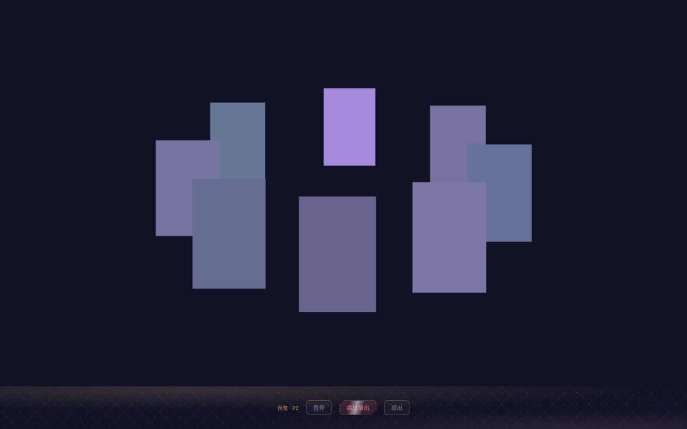
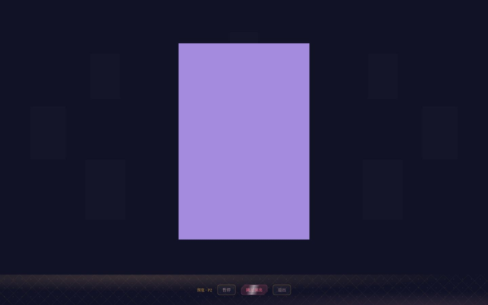
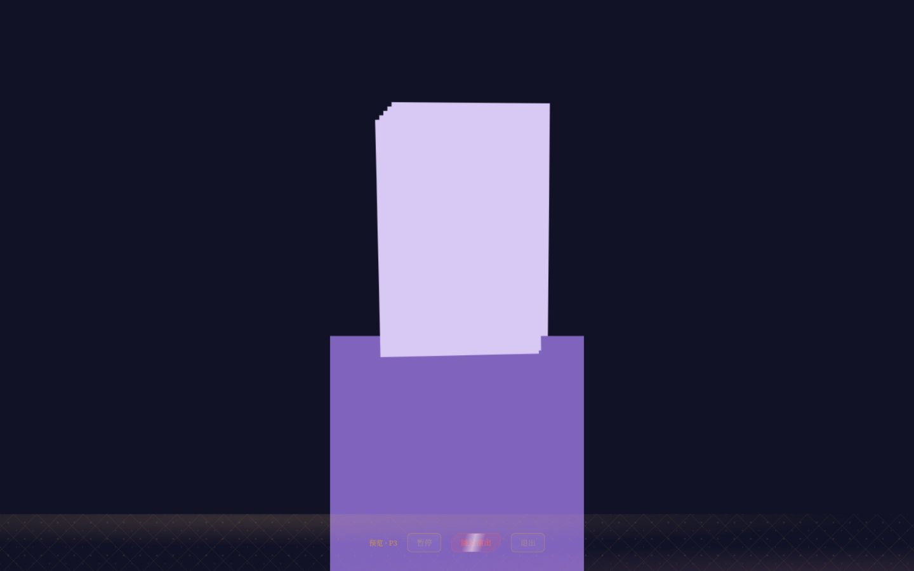
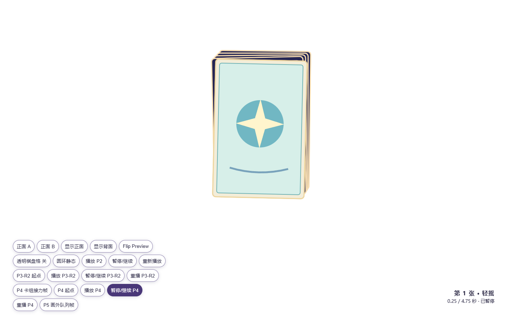
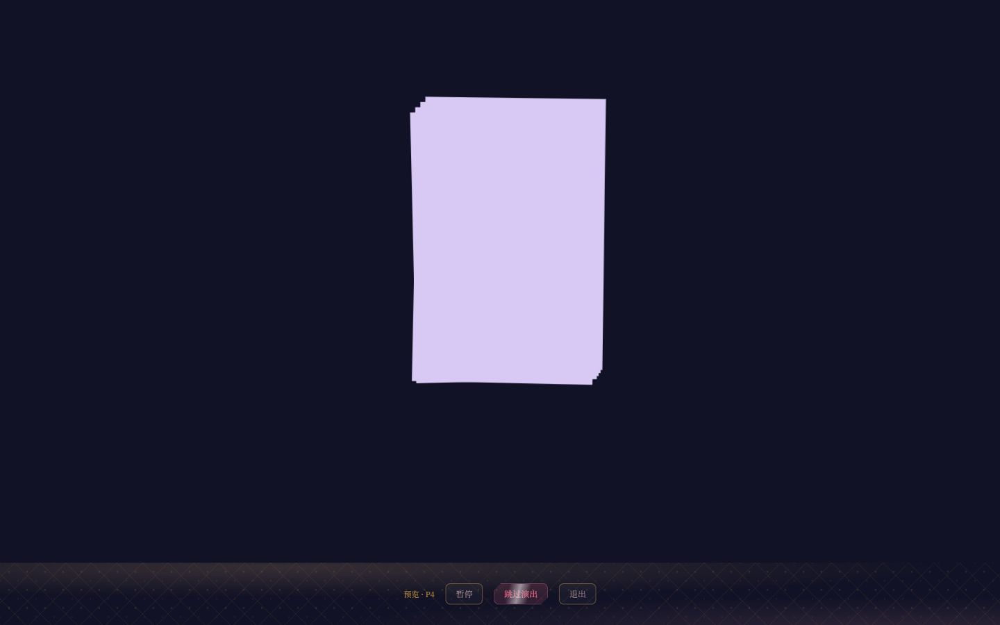
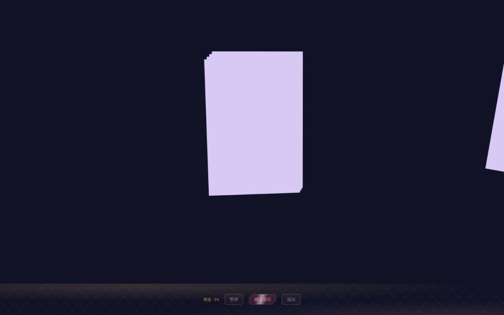
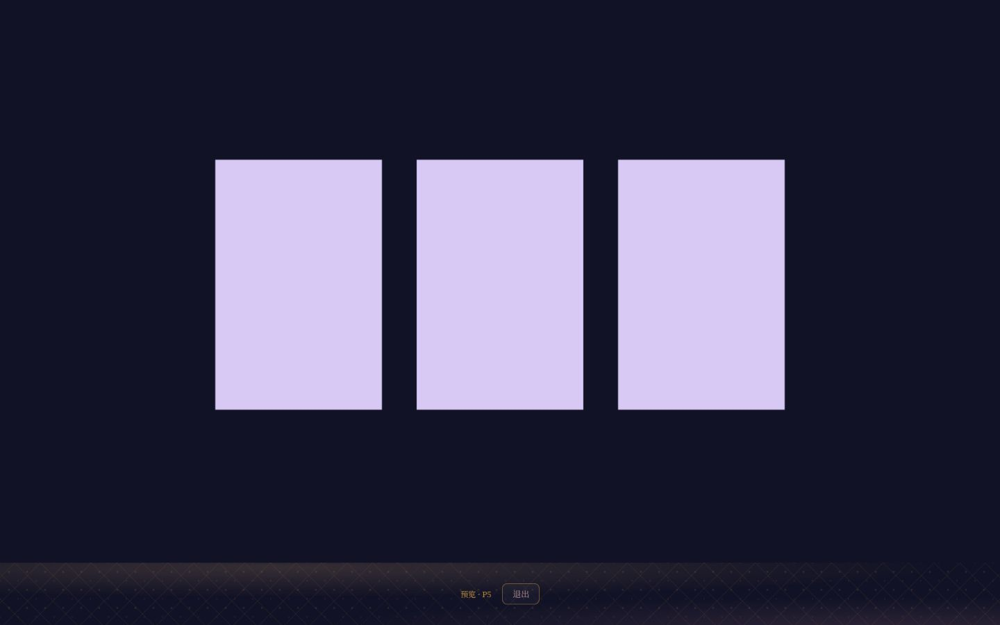
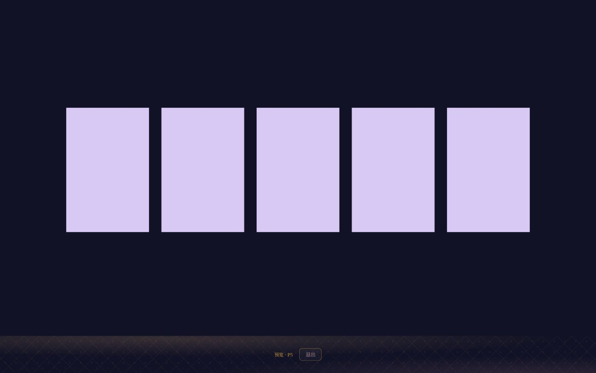
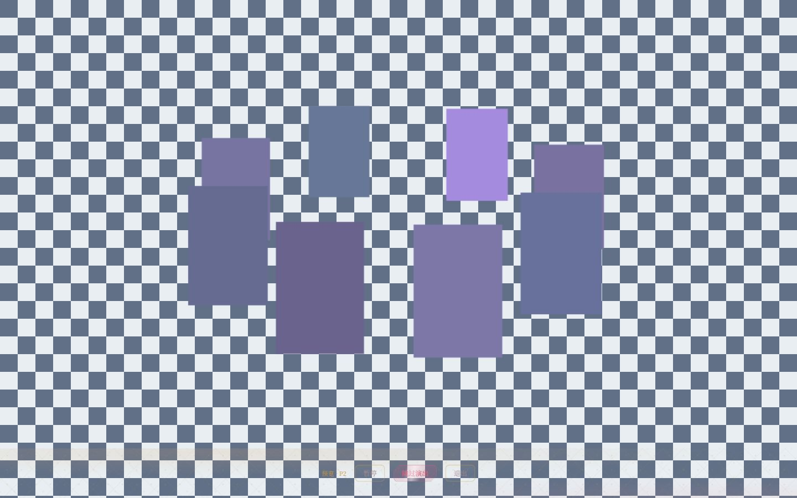
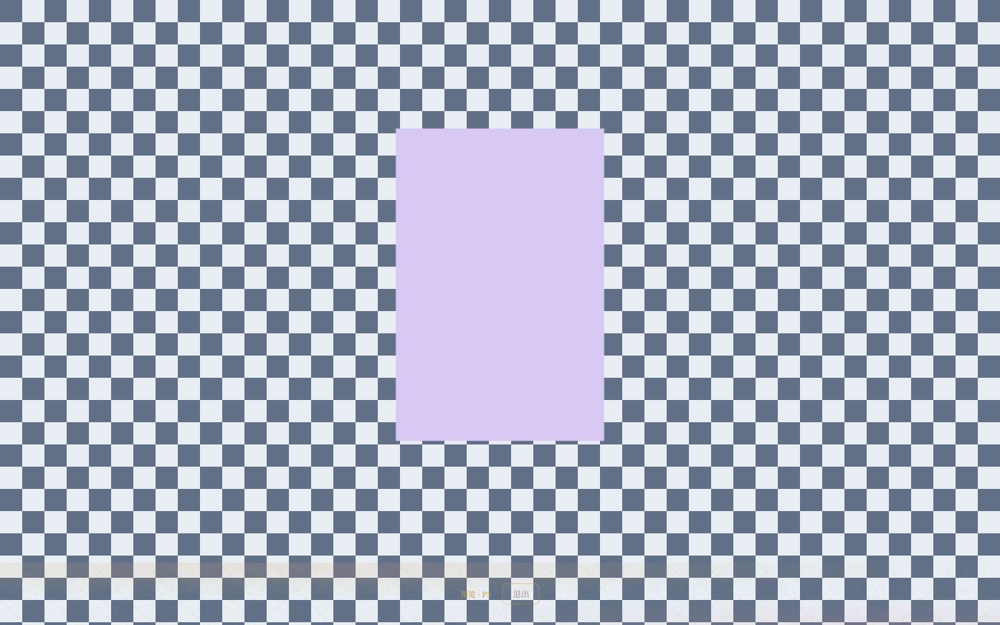

# S4 对齐单 · 星辉启封

基准：owner 冻结的 `prototype.dc.html` / `prototype-notes.md` FINAL；目标画布 1440×900。本单只记录 S4 结构、状态与交互，正式美术留 S5/S6。已使用 owner 已运行的 `http://127.0.0.1:5173/` 服务真渲染自玩；本单仍有待 owner 裁决的视觉降格，不得自行判 S4 PASS。

| # | GDD / 冻结原型承诺 | 结论 | 证据 / 说明 |
|---|---|---|---|
| 1 | 1–5 张有序 `card-0…N-1` 稳定实例，非法 0/6 拒绝 | ✅ | `skeleton.test.ts`、`s4-flow.test.ts`、Doki `contract.test.ts` 通过；无结果卡重建。 |
| 2 | 标准/减少动态均经历 P2→P3→P4→P5；60Hz 定长 | ✅ | `timing.ts` 单一时长表；N1/N3/N5 真引擎测试与 6 场 Doki walkthrough 通过。标准 312/440/569 tick，reduced 129/173/217 tick。 |
| 3 | P2 八包圆环、选中 pack-3、聚焦英雄位、其余外散 | ⚠ 报 owner 裁 | `shots/S4-P2-ring.png`、`S4-P2-focus.png` 实测八包椭圆弧、正面朝镜头与英雄位；无正式包图时用不同色块，重叠处辨识度低于原型，S5 美术边界请 owner 裁。 |
| 4 | P3 互补撕顶、包体下坠与 N 卡上升并行至少 450ms | ⚠ 报 owner 裁 | 数据窗口为 320–820ms；`shots/S4-P3-overlap.png` 证实包体与卡组并行可见。但当前顶片/包体为矩形占位，不具 FINAL 浅弧互补裁片；属 S4 结构还是 S5 美术请 owner 裁。 |
| 5 | P4 逐卡摇动、右飞、下层自然露出且不换实例 | ✅ | `s4-flow.test.ts`、walkthrough B、`shots/S4-P4-sway.png` 和 `S4-P4-flight.png`；中心堆与画外飞出可见，卡面纹样属 S5。 |
| 6 | P5 同实例召回，N1–N5 精确布局、y410/rotation0/alpha1 | ✅ | 测试覆盖 N1–N5；`shots/S4-P5-N1.png`、`N3.png`、`N5.png` 实测终态中心、数量和无重叠。 |
| 7 | Skip 在 P2/P3/P4 一个 tick 内到与自然完成同一终态，单次回执 | ✅ | 游戏侧 P2/P3/P4 skip 测试、Doki walkthrough D/F 通过；完成闸防并发与失败重试。 |
| 8 | Pause/resume、失焦后等待显式恢复；Escape 不伪造 viewed | ✅ | 游戏侧游标/姿态测试与 Doki walkthrough E；真浏览器 P3 暂停 800ms 后画面字节相同，继续/跳过到 P5。失焦与 Escape 由壳层和测试覆盖。 |
| 9 | 1440×900 真渲染至少 7 帧并与冻结原型同画布并排，控制台无 error | ✅ | `shots/S4-*.png` 共 8 张，逐张核对 1440×900；原型、N1/N3/N5 正式页 console error 均 0。下面按同画布列出对照；本行只证明截图/检查已做，不代替偏差裁决。 |
| 10 | 终局每个出口实际可点击、失败重试仍保持稳定画面 | ⚠ 报 owner 裁 | 预览终局仅“退出”，真浏览器确认按钮在画布内且可见；`rejected/throw→retry` 的真实 action 由 walkthrough F 通过，未接正式宿主作浏览器回执失败演练，留独立复查/owner 裁。 |
| 11 | 冻结原型与能力计划要求主舞台及未绘制区域透明，可作为 DokiWorld 叠加演出 | ✅ | 初次独立复查 FAIL：正式宿主曾注入不透明 `sceneBackground`/`wrapperBackground`。已移除并加 `host-transparency.test.ts`；审计底板 `shots/S4-transparent-P2.png`、`S4-transparent-P5.png` 中四角和主体空白区可见双色棋盘格，P5 空白区取样 `(16,16)=(97,112,135)`、`(48,16)=(233,238,242)`；底栏仅占自身 90px。新浏览器标签 console error 0，待非施工人重审。 |

已知阶段性偏差：S4 的 `placeholder:` 卡包/卡面纹理尚未接正式资产和宿主 `faceImageUrl`；包体撕口是几何占位，不能宣称 FINAL 纸包视觉 1:1。两项不应被写成“已对齐”；美术槽接线与降级属 S5，若 owner 要求 S4 即具备对应视觉，请先裁阶段边界。

## 同画布并排对照

| 冻结原型 1440×900 | S4 真渲染 1440×900 | 差异 |
|---|---|---|
|  |  | 椭圆环位置、八包和前后层序已接；正式图案未接，色块交叠辨识偏弱。 |
|  |  | 英雄位约 400×600，其他包外散淡出；尚无包装纹理。 |
|  |  | 卡组从包体后方上升；撕口浅弧/材质缺失，矩形包体在下坠时盖过底栏。 |
|  |  | 位置、堆叠和摇动接力；卡面占位为纯色。 |
|  |  | 右飞与下层自然露出；卡背/卡面图案缺失。 |
|  |  | 数量、中心、尺寸和间距对齐；美术占位。 |
|  |  | 五槽对齐且无重叠；美术占位。 |

另有 `shots/S4-P5-N1.png` 验证单卡主视觉尺寸。

透明专项（审计页只在 `self-check/transparent-audit.html?preview=1` 加双色底层，不进入正式入口）：

| P2 叠底 | P5 叠底 |
|---|---|
|  |  |

迭代记录：第 1 轮（2026-10-10）· 真引擎回归与轨道参数已核；未取得 S4 真渲染关键帧，剩 1 条 ❌、3 条需 owner/视觉复查裁决的 ⚠。本单不收敛。

第 2 轮（2026-10-10）· 对 `session.ts:36` 的 skip 完成态判定做精确撤修，先以文本锚点确认命中；P2/P3/P4 三组 skip 用例准确转红（其余 6 组通过），随后恢复原代码并复跑 9/9 通过。此举只证明测试能守住该终态分支，不替代真渲染目击；❌ 与 ⚠ 数量未变。

第 3 轮（2026-10-10）· 使用 owner 已运行的 5173 HTTP 页面完成真渲染自玩。目击发现撕片/包体终态残留与底栏纵排裁切，已分别修复并重测；P2 改为沿椭圆弧的数据采样轨道，卡包保持正面朝镜头。八张 PNG 与 1/3/5 终态已保存；剩 0 条 ❌、3 条须 owner 裁决的 ⚠。本单机器可收敛，但不代替 owner/独立复查判词。

第 4 轮（2026-10-10）· S4 独立复查以不透明宿主背景判 FAIL；施工仅撤 `sceneBackground`/`wrapperBackground`/`sceneBgSkin`，保留透明 CanvasRenderer。新增纯配置 + happy-dom host 测试；用现有 5173 服务审计页在同页底层铺棋盘格，P2/P5 合成证明四角与未绘制区透底。首次 iframe 审计页曾有两条无法归因的 MutationObserver 日志，已改为同页入口并用全新标签复验 error 0；不把旧日志隐去。剩 0 ❌、3 ⚠，再次送非施工人复查，不自评 PASS。

第 4 轮（2026-10-10）· 非施工人独立复查真渲染与冻结原型时发现透明舞台被正式入口的两处硬编码深色背景破坏，新增 1 条 ❌ 并退回；此前截图无法作为透明输出证据。S4 暂不通过。

第 5 轮（2026-10-10）· 非施工人再次独立复跑全部门禁，并对透明配置做带锚点撤修验红；1440×900 真浏览器下 P2/P5 的 html、body、app、wrapper、canvas 五层均透明且 console error 0。8✅、3⚠（均有 S5/S6/S8 去向）、0❌，S4 独立复查 PASS。
