# S5 对齐单 · 星辉启封

基准：owner 已冻结的 `../prototype.dc.html`、`../prototype-notes.md`、`../ui-refs/final/` 与 P3/P4/P5 关键帧。目标与实测均为 1440×900 逻辑画布。冻结原型关键帧来自既有文件；真实游戏关键帧来自 owner 已启动的 `http://127.0.0.1:5173/dokiworld/game-card-reveal/src/index.html?preview=1&cards=N`。浏览器自动化的 URL 策略仅允许 HTTP(S)，拒绝 `file://`；此限制没有降低同画布视觉、状态和时序验收标准，也未尝试绕过。下方真游戏截图是浏览器完整页面 JPEG，白色是透明舞台在浏览器默认白底上的合成，透明本身另由 S4 棋盘格合成截图及宿主测试证明。

| # | 冻结目标 / S5 承诺 | 结论 | 真实证据及差异去向 |
|---|---|---|---|
| 1 | P2 八包圆环使用正式统一包装，空间锚点/遮挡与 FINAL 一致 | ✅ | `shots/S5-P2-ring-full.jpg` 对 `../ui-refs/final/final-p2-ring.png`；八包外轮廓和层序同画布对应，已替换 S4 色块。截图取圆环起势后约 0.2s，避免把转动中间帧误当 FINAL 静帧。 |
| 2 | P2 聚焦英雄包、其余外散；真实包图不断档 | ✅ | `shots/S5-P2-focus.jpg` 对 `../ui-refs/final/final-p2-focus-end.png`；`pack.front` 在稳定实体槽消费，未新增图外粒子或背景。 |
| 3 | P3 顶片/包体同源浅弧互补，卡组上升与包体下降并行 | ✅ | `shots/S5-P3-tear.jpg` 对 `../ui-refs/p3-r2/p3r2-body-stack-overlap.png`；约进入 P3 420ms，顶片飞出、卡组从包体后上升，body 保持同源包装纹理。轨道仍由 S4 定序能力消费。 |
| 4 | P4 第一张飞出、第二张自然显现，卡面不换实体 | ✅ | S5 初次所留 `shots/S5-P4-first-flight.jpg`、`S5-P4-second-reveal.jpg` 证明稳定实例接力，但当时漏检首卡终态右边缘露角；owner 在 S6 真机发现并退回。现按冻结 x=1620+20i 修复，追加 `shots/S6-P4-first-offscreen.jpg` 与 `S6-alignment.md` 的 AABB/像素核证，替代初次“飞出完整”的错误自评。 |
| 5 | P5 一、三、五张终态数量、中心、间距与退出态 | ✅ | `shots/S5-P5-N1.jpg`、`S5-P5-N3.jpg`、`S5-P5-N5.jpg` 对 `../ui-refs/p5/p5-n1-final.png`、`p5-n3-final.png`、`p5-n5-final.png`；只在 P5 且底栏仅剩“退出”时取帧，非 P5 起点过渡帧。三条自然完整回放 console error 均 0。 |
| 6 | 宿主单卡加载失败独立回退，结果数量不变，不泄漏 URL | ✅ | `shots/S5-fallback-N3.jpg` 为仅在本地 preview 启用的 `fallbackCard=1` 故障夹具：第二张显示包内 `card.fallback`，其余两张保持原预览图，底栏明确提示“1 张卡面加载失败”；终态只有“退出”，console error 0。正式 HTTPS 逐卡失败由 `card-assets.test.ts` 验证同一回退路径。 |
| 7 | 任意宿主宽/窄/2:3 卡面在 260×390 框内 cover，不拉伸 | ✅ | `card-assets.test.ts` 对 900×300、120×600、260×390 的源裁片与 260×390 目标框逐项断言；1/3/5 Sprite 均声明 `fit:'cover'`。通用能力 GAP-CARD-REVEAL-02 由独立复查 PASS，本游戏不改 `src/**`。 |
| 8 | 底栏 LayoutNode、house 主题、暂停/继续/跳过/退出状态正确 | ✅ | `shots/S5-paused.jpg` 的暂停态只保留“继续/退出”；`screen.test.ts` 的 LayoutNode validator 零 issue、loading/error/retry/terminal 状态断言；1440×90 `ui-audit` 阻断项 0。真机 P5 仅退出，键盘聚焦按钮不重复提交 skip。 |
| 9 | 主舞台透明、底栏只占 90px，不因 810×506 反向改逻辑布局 | ✅ | `host-transparency.test.ts` 与 S4 `shots/S4-transparent-P2.png`、`S4-transparent-P5.png`；本轮 10 张真实截图均 1440×900。白底只是截图查看器默认合成，不是页面 scene/canvas 背景。 |
| 10 | 包图/撕片/备用卡/预览卡本地索引与消费槽闭包 | ✅ | 本地 index 10 key、待审 0、9/9 真实 ledger 消费槽、0 orphan；`pack.back` 为已批准库存而非虚构可见槽。四 PNG 经 owner A 判词与 M2.5 approve，哈希/审批字段齐。 |
| 11 | 正式宿主远程 HTTPS 图片的最终跨源/CORS 兼容 | ⚠ 裁决去向：S8 宿主接入复验 | S5 的 AssetManager 路径、乱序/重复 URL/逐张失败与稳定 key 均有自动测试；本地真机截图使用包内 preview 图，不冒称已在真实 DokiWorld 宿主测过各种远程 CORS 响应。S8 应用真实宿主样本与失败域名复验。 |
| 12 | 正式包装与卡面最终美术评分 | ⚠ 裁决去向：S6 owner 视觉人门 | 四张包装已获 owner 资产审核 A，但 S5 不代签最终美术 1:1。包内卡面是明确的 preview/fallback 占位；真实卡面来自正式宿主 HTTPS 输入。S6 对包装亮度、箔线、撕口细节及正式卡面样本作最终视觉裁决。 |

## 同画布关键帧对照

| 冻结原型（既有文件） | 真实游戏（HTTP 浏览器） | 观察 |
|---|---|---|
| 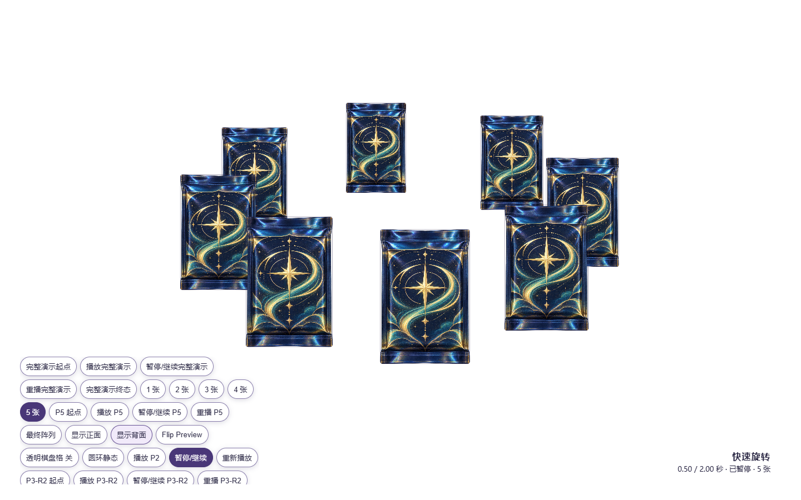 | 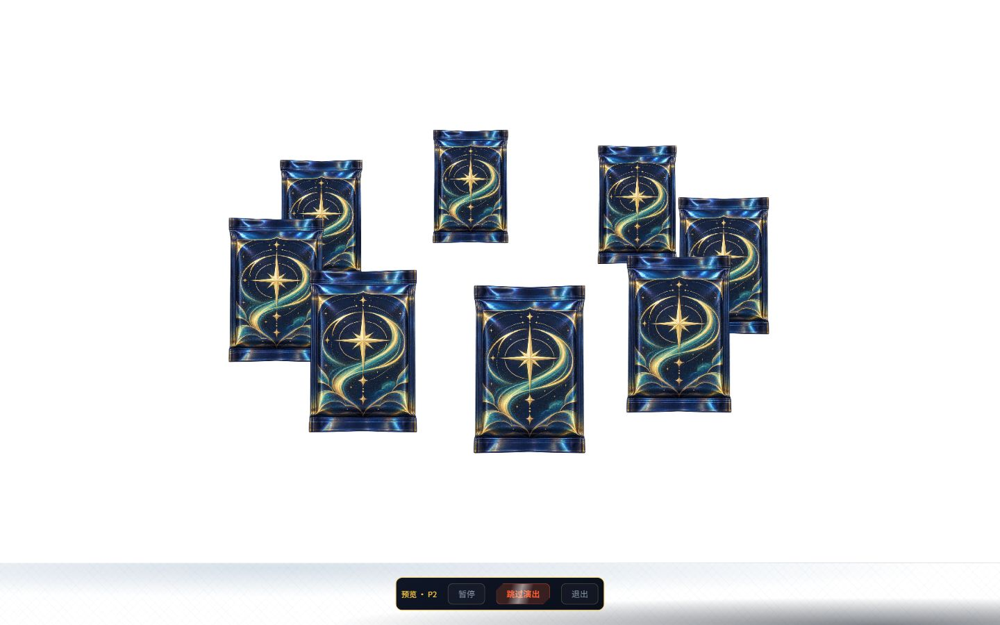 | 八包层序、占位与统一包装已对应；原型调试控件不是产品底栏。 |
| 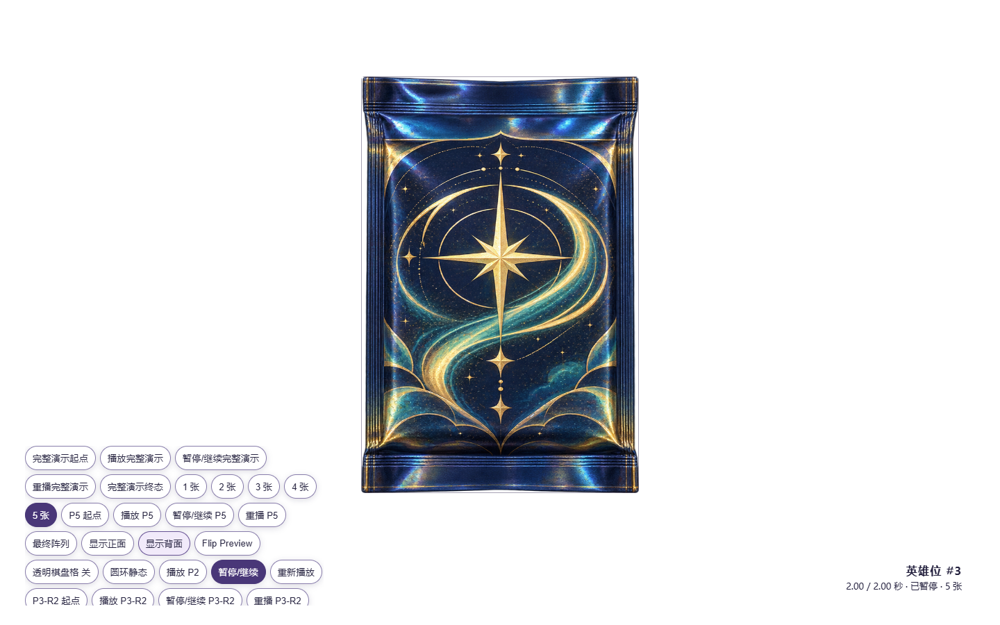 | 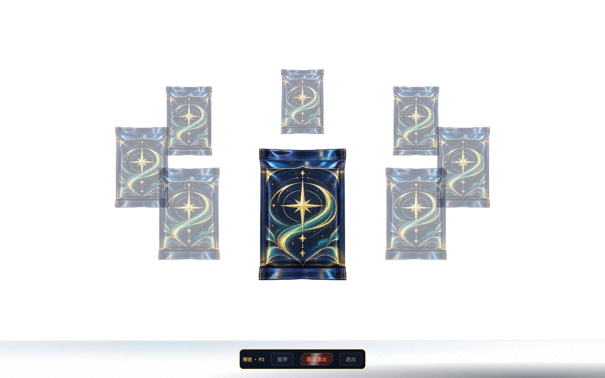 | 选中包在英雄位；未向舞台添加不透明底色。 |
| 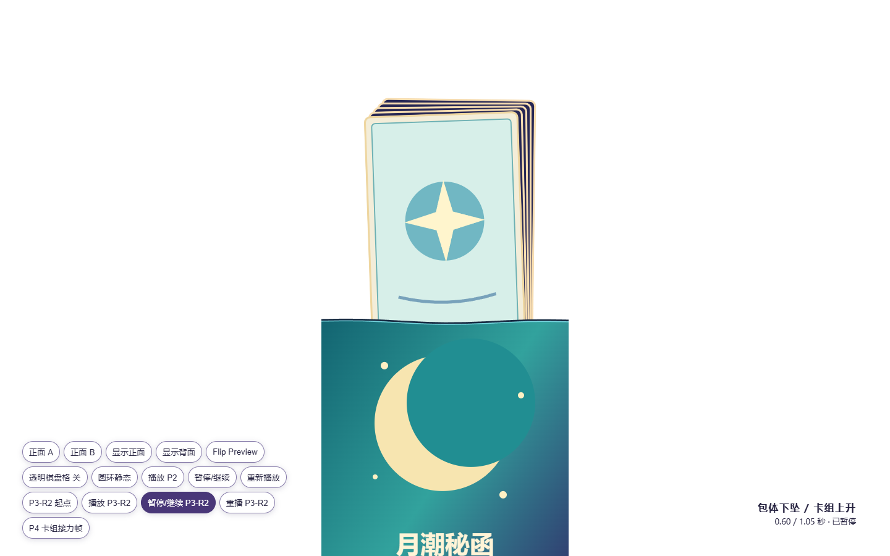 | 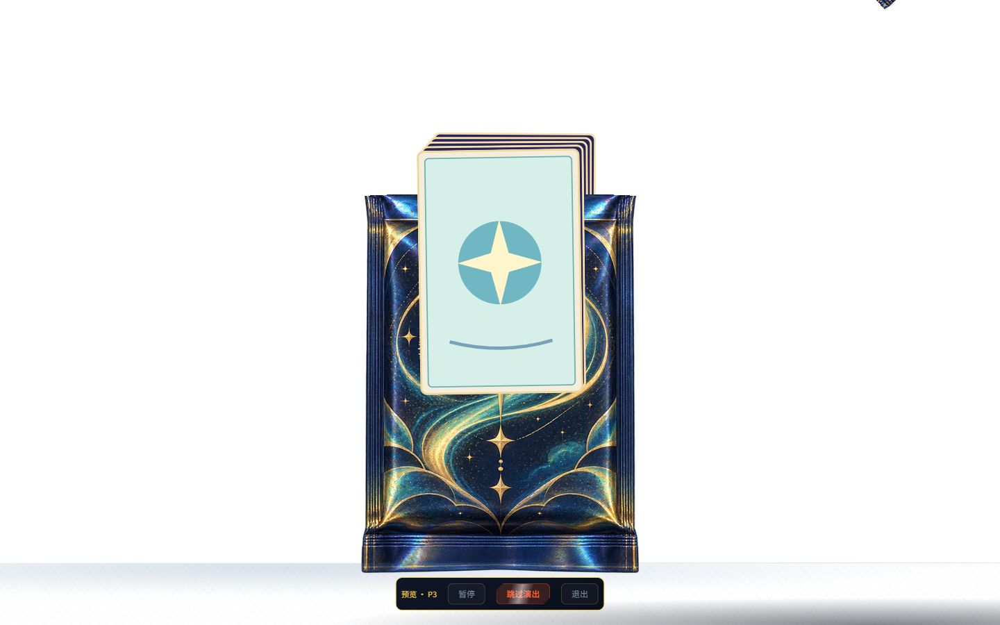 | 包体/卡组并行与上层遮挡关系保留。 |
| 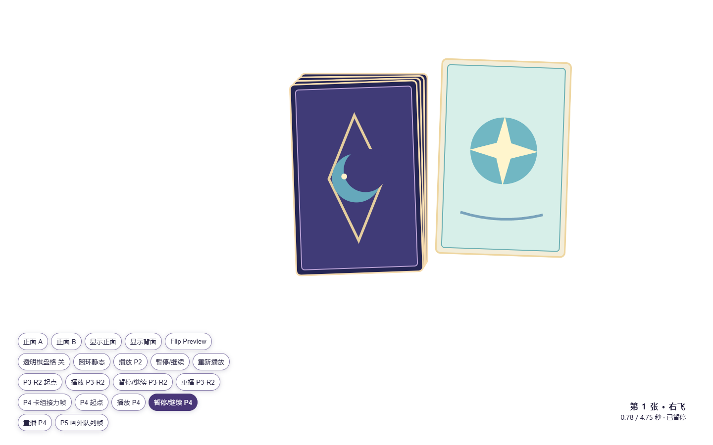 | 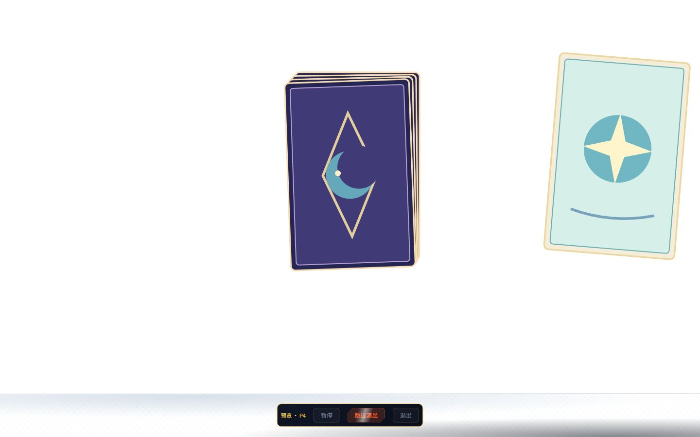 | 同一稳定卡实例飞出，下一张在堆栈露出。 |
| 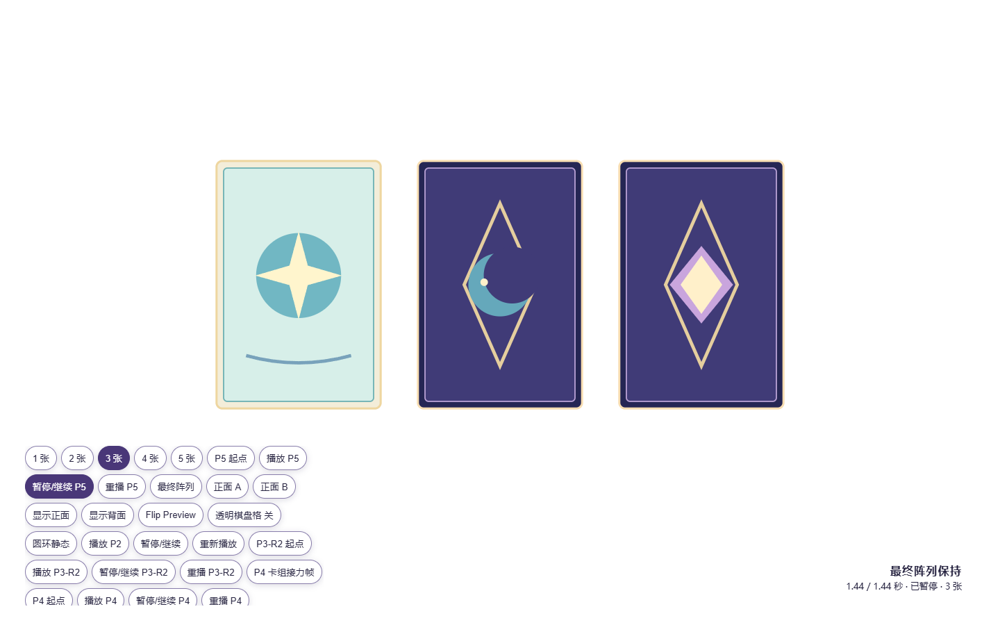 | 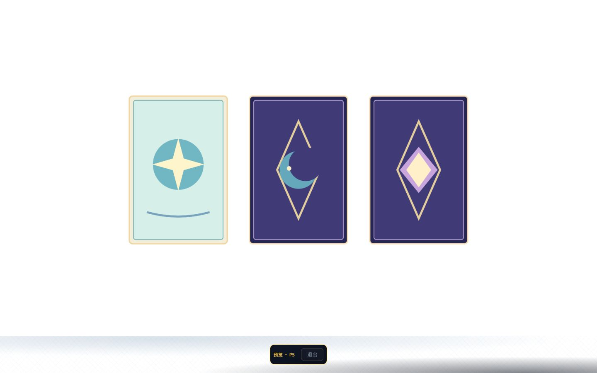 | 终态等数量和横排；正式图由宿主输入替换预览占位。 |
| 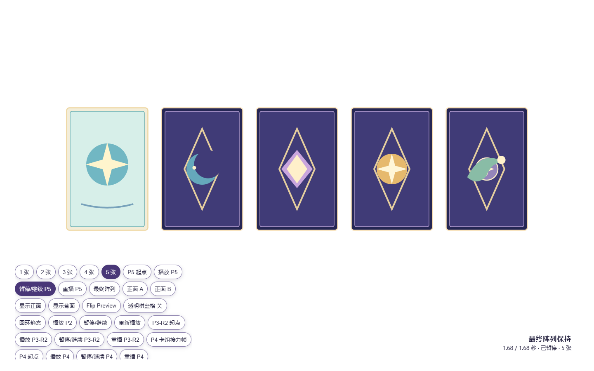 | 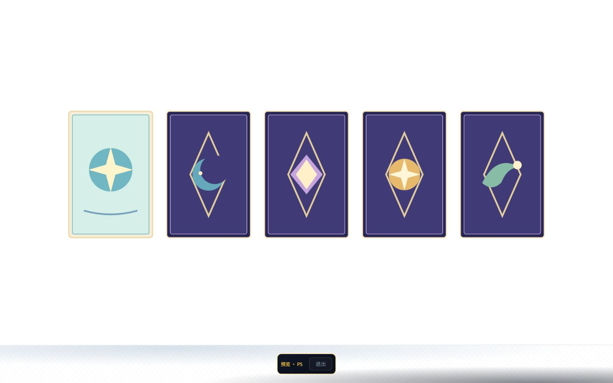 | 五张无重叠，底栏只剩退出。 |

迭代记录：首次采样把 P3/P5 的阶段起点帧误标为并行/终态，且新标签默认 1280×720。已逐张复核图像、在每个标签创建后显式设置 1440×900，P5 改为等待“仅退出”才取帧，错误截图已覆盖；当前 S5 JPEG 全部由文件尺寸检查确认为 1440×900。`file://` 自动化拒绝访问已复核，保持冻结原型文件不动，真实游戏仅用 owner 已启动的 HTTP 入口取证。

S6 追认纠错（2026-10-10）：owner 对 P4 终帧右缘提出残角缺陷；S5 第 4 行初次 ✅ 对“完全离屏”的覆盖不足，不能以 S5 旧截图冒充通过。已补真实旋转 AABB 六组点名测试并按冻结终点修正，另取新的 P4 右边缘截图；独立复查仍待非施工人完成，详 `S6-alignment.md` 与 `../review/S6.md`。
