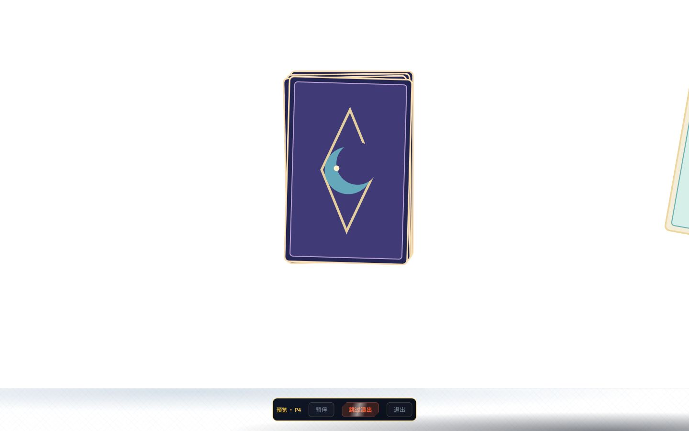
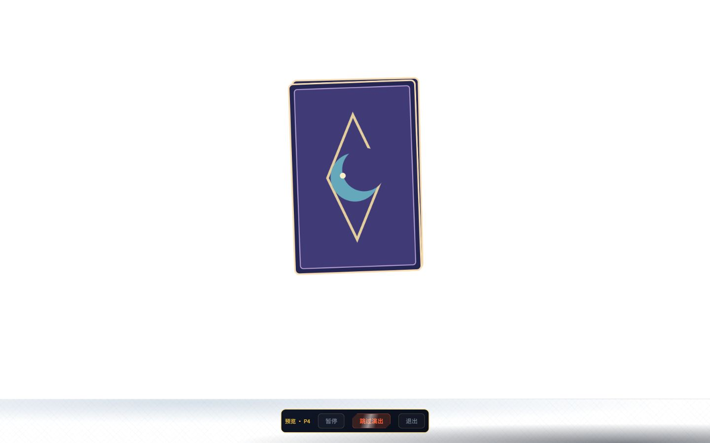
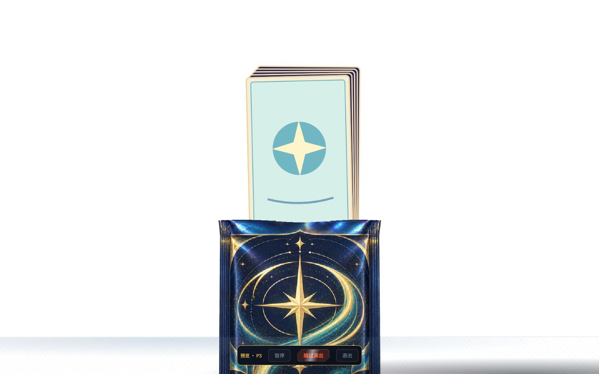

# S6 owner 视觉返修对齐单 · P4 完整离屏 / P3 包后抽卡

范围为 `requests.md` 两项 S6 owner 视觉返修：P4 首卡完整离屏、P3 卡组从包体后方抽出。目标侧为 owner 冻结的 `../prototype.dc.html` 与 P4/P3 关键帧；真实游戏侧为 owner 已启动的 `http://127.0.0.1:5173/dokiworld/game-card-reveal/src/index.html?preview=1&cards=3` / `cards=5`，1440×900 浏览器截图。原型已有 FINAL 关键帧用于对照；`file://` 自动化安全策略未改变，未绕过。

| # | 冻结承诺 / 返修要求 | 结论 | 证据 / 说明 |
|---|---|---|---|
| 1 | P4 飞出队列终点 `x=1620+20i`，不是退化的 `1560+20i` | ✅ | `prototype.dc.html` 中冻结表达与 `games/game-card-reveal/tracks.ts` 的 `queuedX` 同值；只改轨道数据，不改时长、alpha、Visibility、卡序或引擎。 |
| 2 | 标准/减少动态、N=1/3/5、每张飞出完成后旋转 AABB 左界 ≥1440 | ✅ | `s4-flow.test.ts` 六组真引擎测试按 Sprite `width/height`、Transform `scaleX/scaleY/rotation` 算包围盒；首卡最紧标准左界约 1446.697px（余量 6.697px），减少动态为 1490px。还断言 visible=true、alpha=1，非隐藏式修复。 |
| 3 | P5 从同一离屏姿态召回相同卡实体 | ✅ | 同六组测试在每张 P4 完成时保留 Transform，P5 启动时逐张比对完全相等；终局实体 id 集合不变且各卡回到 `finalLayout` 横坐标。 |
| 4 | 首卡已完整离屏，第二张仍在画布中心；右边缘零前卡残留 | ✅ | `shots/S6-P4-first-offscreen.jpg`，1440×900，P4 阶段约首卡飞出后 1.01s；次卡在中央、右边缘空白。对截图主舞台 `x=1430..1439, y=0..809` 的 8100 像素检查，RGB 任一通道 <245 的非白像素为 0；浏览器 console warn/error 0。 |
| 5 | 失败回退 1560 必须准确转红，修复后仍全绿 | ✅ | 只暂改 `queuedX` 锚点为 1560，六组均在 AABB 断言转红：标准首卡左界 1386.697px、减少动态 1430px；恢复 1620 后定向测试 15/15。 |
| 6 | P3 采用冻结绘制顺序：卡组 → 剩余包体 → 飞行顶片 | ✅ | 冻结 `prototype.dc.html` 的 `p3Draw` 保持不变；正式 `blueprint.ts` 将顶片/包体静态 zOrder 设 30/29，N≤5 卡牌最高 25，满足 top > body > every card。未改坐标、时序或素材。 |
| 7 | P3 真正同时可见时，包体遮住卡牌下半部 | ✅ | 新增 `s6-layering.test.ts`，standard/reduced × N1/N3/N5 的实际 P3 tick 读取 Sprite/Visibility/Color，确认顶片、包体、所有卡 visible=true 且 alpha>0，再断言 z 序。`shots/S6-P3-mid-overlap.jpg` 真渲染见卡牌从开口后升出、下半部被前景包体遮住。 |
| 8 | 卡组内次序、P4/P5 实体身份与层级不回归 | ✅ | 同六组测试确认 card-0 在所有后续卡之前；P4 逐 tick 层级数组不变，P5 terminal 的卡实体 id 与层级数组不变。已有 P4 飞出/召回测试仍通过。 |
| 9 | 回退旧包体 zOrder=24 时准确转红 | ✅ | 仅将 `tear-body` 的唯一锚点 29 临时退回 24，定向 6 测试中 N5 standard/reduced 精确 2 failed/4 passed（卡首张 z=25）；恢复 29 后全游戏 31/31。 |
| 10 | P3 冻结/正式帧并排，页面无告警 | ✅ | `../ui-refs/p3-r2/p3r2-body-stack-overlap.png` 对 `shots/S6-P3-mid-overlap.jpg`；另有初始露头帧 `shots/S6-P3-overlap-close.jpg`。两帧均 1440×900，owner 既有 5173 隔离标签，console warn/error 0；标签关闭、视口 reset。 |

| 冻结 P4 关键帧 | S5 旧帧（曾漏检） | S6 修复后帧 |
|---|---|---|
|  |  |  |

| 冻结 P3 包后抽出关键帧 | S6 正式 P3 中段交叉帧 |
|---|---|
|  |  |

迭代 1（2026-10-10）：先实查原型终点 1620 与正式 1560 的差，补六组实际旋转 AABB 测试；修为 1620。撤修回 1560 六组准确转红，恢复后定向 15/15。随后在 owner 既有 5173 的 1440×900 HTTP 页面真渲染截帧并检查右侧 8100 像素、console warn/error；P4 五项均 ✅，已获非施工人技术复查 PASS。

迭代 2（2026-10-10）：owner 真机指出 P3 卡牌贴在包体前方。实查冻结 `p3Draw` 次序与正式 zOrder 后只调整 `tear-top/tear-body` 为 30/29；六组 P3 同时可见 tick 测试与撤修验红通过。5173 抓取 1440×900 初露头和中段交叉帧，后者可直接看出前景包体遮挡卡下半部；console warn/error 0。当前合计 10✅、0⚠、0❌。P3 新返修只送非施工人独立复查，不代表 S6 owner 人门 PASS。
