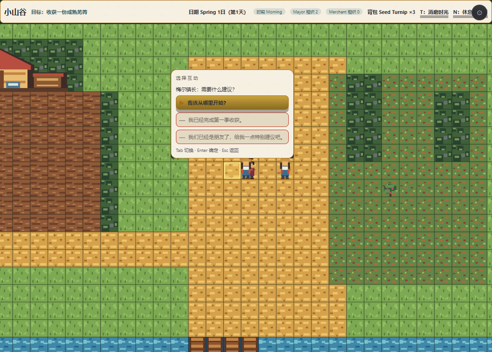
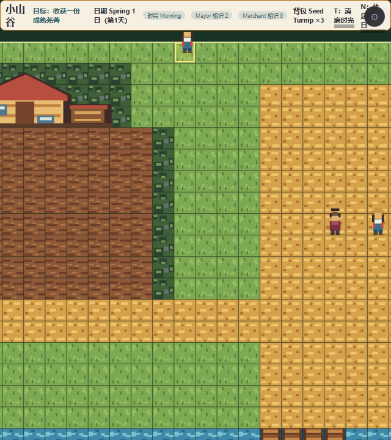
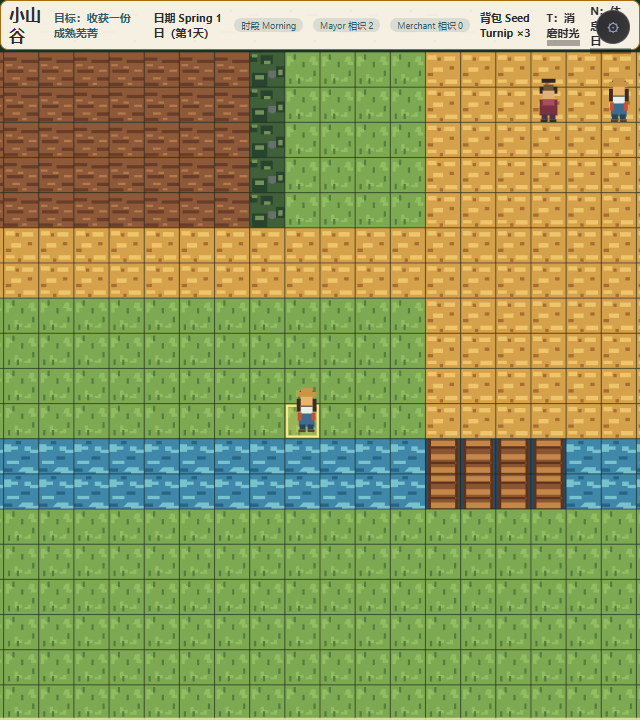
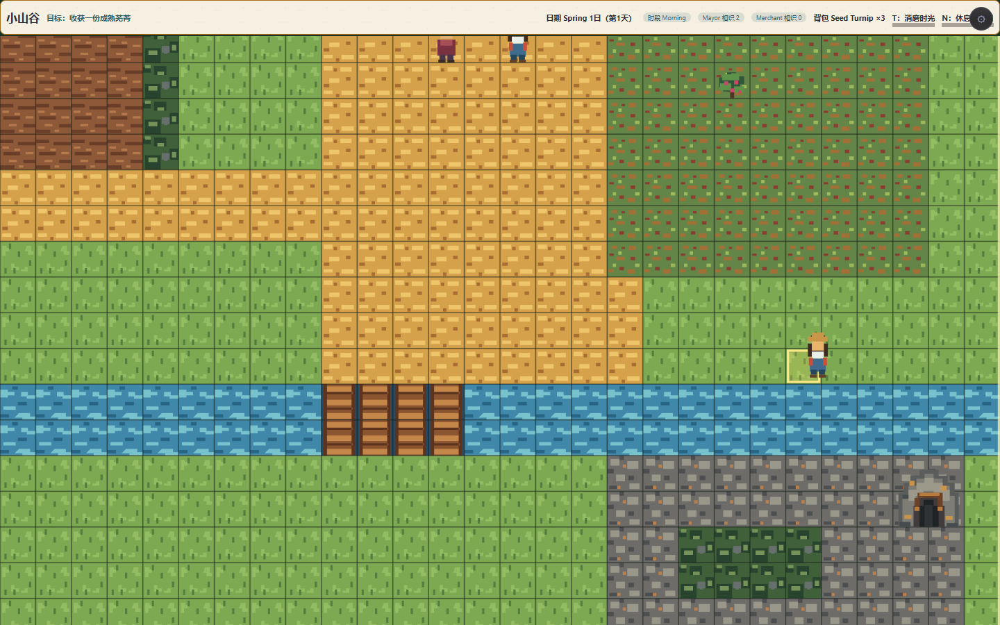
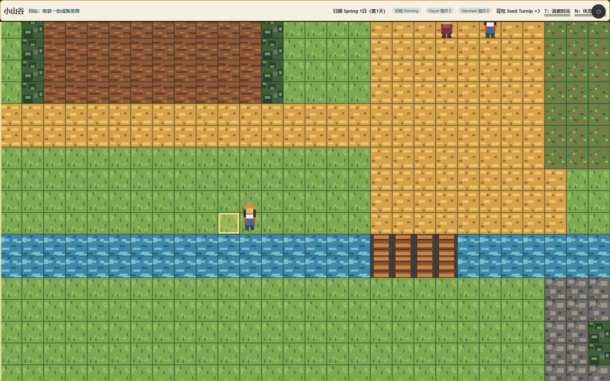

# SIMLIFE-ENG-18 真渲染与对齐单

## 结论

LifeHost 的活动对话、连续坐标、当前格高亮与 responsive-cover 相机已在真实 Little Valley 构建产物中目击。截图由任务级隔离无头 Edge 直接加载本次成功构建的 `dist`，没有启动应用服务；浏览器在验收后关闭，临时 capture 脚本已删除。

## 截图

| 证据 | 视口 | 覆盖 |
| --- | --- | --- |
| `viewport-1060x760-start.png` | 1060×760 | 正常世界、HUD、玩家脚点与当前格高亮 |
| `dialogue-1060x760.png` | 1060×760 | E 后下一次 host paint 自动出现 LayoutNode 对话菜单；Tab/Enter 帮助与鼠标按钮同屏 |
| `edge-top-left-640x720.png` | 640×720 | 窄屏顶部/左侧有效相机与 HUD 安全区 |
| `edge-bottom-640x720.png` | 640×720 | 窄屏底部；玩家和高亮不离开 play-field |
| `edge-right-1440x900.png` | 1440×900 | 宽屏右侧；地图、玩家、高亮共享有效相机 |
| `edge-left-1440x900.png` | 1440×900 | 宽屏左侧；地图、玩家、高亮共享有效相机 |
| `route-debug.png` | 1060×760 | 连续移动后的脚点/逻辑格诊断帧 |

## 逐条对照

| 验收项 | 结果 | 证据 |
| --- | --- | --- |
| 对话下一 paint 自动开面板 | ✅ | `dialogue-1060x760.png`；真实 `mountLifeGame` 路径；host 集成测试 |
| 活动会话离开 proximity 仍可推进 | ✅ | presenter/interaction 点名测试通过语义移动离开，不直写 World；Tab/Enter/pointer 等价回归 |
| 对话期间移动锁与 held release | ✅ | host 与真实 Little Valley 集成测试覆盖旧 held stop、拒绝新 start、关闭后恢复 |
| terminal close 归还权威 | ✅ | queued `life.dialogue.close` 仅在 `line + next:null` 销毁专用 session；可再次开启 |
| 连续脚点无重复半格 | ✅ | 任意 cellSize 坐标测试；撤修旧公式时点名用例转红 |
| 当前逻辑格高亮 | ✅ | 七张实际世界帧均可见金色半透明格；仅 renderer local，不写 World |
| 640/1060/1440 与四边 clamp | ✅ | 上述五张主证据；3×4 renderer 参数矩阵；Canvas/WorldUI2D 浮点精确一致 |
| snapshot/hash 不变 | ✅ | responsive projection/hash 回归；Camera/World 无写入 |
| LayoutNode/UI hygiene | ✅ | 640×668、1060×708、1440×848 audit 均 overlap 0、硬/警告对比 0、border-image 0 |

## 环境说明

owner 已运行的 `http://localhost:5173/` 曾可只读访问并产出首帧；随后同工作树的无关 `src/skills/tier3/narrative-director.ts` 语法错误令该服务返回 500。未越界修改该文件，也未重启服务。最终截图改为读取此前已成功生成、包含 ENG-18 修改的 `dist`，通过 Playwright request interception 提供静态文件，不存在常驻服务。构建图像完整；隔离路由记录到 3 个非阻断静态 404 console 消息、无 pageerror，必需 Canvas/LayoutNode/素材均正常呈现。
